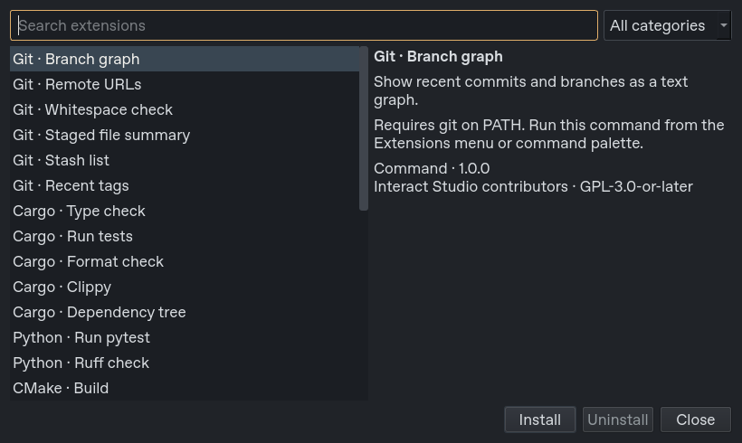

# Interact Studio

**Un IDE natif et léger pour Windows et Linux.** Éditez, lancez et partagez un projet dans une interface Qt compacte, avec des panneaux et des raccourcis que vous pouvez adapter.

[Licence GPL-3.0 ou ultérieure](LICENSE)

| Système | Télécharger Interact Studio 0.2.0 |
| --- | --- |
| Windows 10/11 x64 | [Installateur .exe](https://github.com/KAYTAY10ok/interact-studio/releases/download/v0.2.0/InteractStudio-v0.2.0-windows-x86_64-setup.exe) · [ZIP portable](https://github.com/KAYTAY10ok/interact-studio/releases/download/v0.2.0/InteractStudio-v0.2.0-windows-x86_64.zip) |
| Debian 12 amd64 | [Paquet .deb](https://github.com/KAYTAY10ok/interact-studio/releases/download/v0.2.0/interact-studio_0.2.0_amd64.deb) · [Archive portable](https://github.com/KAYTAY10ok/interact-studio/releases/download/v0.2.0/interact-studio-v0.2.0-linux-x86_64.tar.gz) |

[Guide d’installation](docs/installation.md) · [Notes de version et sommes SHA-256](https://github.com/KAYTAY10ok/interact-studio/releases/tag/v0.2.0) · [Compiler depuis les sources](docs/developpement.md)

## Prise en main

1. Ouvrez votre dossier avec **File → Open workspace…**. **Explorer** permet de créer, renommer et ouvrir les fichiers.
2. Appuyez sur `Ctrl+P` pour trouver un fichier et sur `Ctrl+Maj+P` pour lancer une commande. `Ctrl+Espace` affiche les suggestions et `Tab` accepte celle qui est sélectionnée.
3. Utilisez **Source control** pour relire les changements, les indexer et les partager. Utilisez **Go Live** pour ouvrir une page HTML locale et la recharger quand les fichiers changent.
4. Ouvrez **Preferences** avec `Ctrl+,` pour régler l’enregistrement, le clavier et l’apparence. Les panneaux sont déplaçables et les dispositions peuvent être nommées.

La coloration couvre 42 profils. Des serveurs locaux facultatifs enrichissent les suggestions et la navigation pour les langages pris en charge. Les extensions de Studio ajoutent des commandes et des réglages, tandis que les outils externes sont lancés à la demande.

[Guide de l’éditeur](docs/editor.md) · [Git et GitHub](docs/git.md) · [Guide de personnalisation](docs/customization.md) · [Catalogue des extensions](docs/extensions.md)

Voir le catalogue d’extensions

Sous Linux, les sessions interactives s’affichent dans le terminal intégré. Sous Windows, les shells interactifs utilisent une console séparée et la sortie des tâches s’affiche dans Studio.

## Développement

Studio est écrit en C++17 avec Qt Widgets. Les tests et le benchmark de frappe se lancent depuis les sources. Les résultats de performance dépendent de la machine et du projet. [Instructions de compilation et de test](docs/developpement.md) · [Procédure de publication](docs/publier.md)
