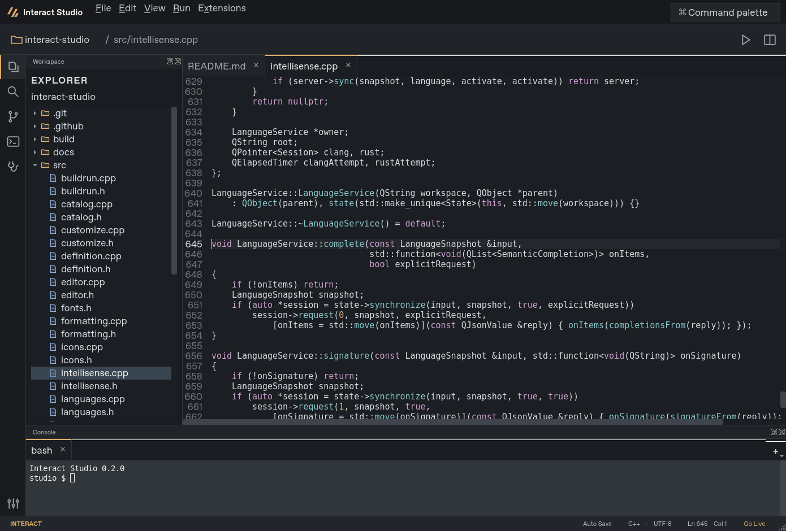

# Interact Studio

IDE natif pour Windows et Linux, écrit en C++17 avec Qt Widgets. Son interface reprend la densité des éditeurs de bureau, avec des panneaux déplaçables, des commandes au clavier et des réglages que chaque utilisateur peut modifier.



## Télécharger

Les [releases GitHub](https://github.com/KAYTAY10ok/interact-studio/releases) proposent un installateur et un ZIP portable pour Windows x64, ainsi qu’un paquet et une archive pour Debian 12 amd64. Le [guide d’installation](docs/installation.md) explique les prérequis et la vérification du téléchargement.

## Compiler et lancer

Sur la machine Codex Cloud Debian 13, préparez les en-têtes et le terminal sans droits administrateur.

```sh
./tools/cloud-setup.sh
make -j2
./build/interact-studio . src/main.cpp
```

Sur une distribution qui fournit Qt 5 et QTermWidget 5, installez le compilateur C++17, Make, pkg-config, les paquets de développement Qt 5 et QTermWidget 5, Git et ripgrep, puis utilisez les deux dernières commandes. Par exemple, sous Debian 12, les paquets sont `build-essential pkg-config qtbase5-dev libqtermwidget5-1-dev git ripgrep`.

Sous Windows, ouvrez le terminal **MSYS2 UCRT64** puis compilez avec Qt 5 et CMake.

```sh
pacman -S --needed mingw-w64-ucrt-x86_64-{gcc,cmake,ninja,qt5-base}
cmake -S . -B build/windows -G Ninja -DCMAKE_BUILD_TYPE=Release
cmake --build build/windows --parallel 2
ctest --test-dir build/windows --output-on-failure
./build/windows/InteractStudio.exe
```

## Travailler dans un projet

| Raccourci par défaut | Action |
| --- | --- |
| `Ctrl+P` | Trouver un fichier par son nom ou son chemin |
| `Ctrl+Maj+P` | Ouvrir la palette des commandes |
| `Ctrl+Maj+F` | Chercher du texte dans le projet |
| `Ctrl+S` | Enregistrer le fichier |
| `Ctrl+Espace` | Compléter un mot à partir du document |
| `F12` | Aller à la définition via `clangd` ou `rust-analyzer`, si installé |
| `F5` | Compiler puis exécuter le fichier C++ ou Rust courant |
| `Ctrl+Entrée` | Lancer une tâche du projet, par exemple `make` ou `cargo run` |
| Ctrl + touche accent grave | Afficher ou masquer la console |
| `Ctrl+,` | Ouvrir les préférences |

L’éditeur propose des onglets, une coloration syntaxique, une deuxième vue synchronisée sur le fichier actif, et la recherche par fichier. Il ouvre les textes UTF‑8 jusqu’à 16 Mio, préserve les fins de ligne et vérifie les modifications sur disque avant d’écraser un fichier. Pour un projet à plusieurs fichiers, lancez la commande de build du projet via **Run workspace task…**. **Build and run current file** cible les programmes autonomes et requiert un compilateur C++ ou `rustc`.

Le panneau **Source control** sépare les changements locaux et indexés. Utilisez **Stage** ou **Unstage** sur le fichier sélectionné. **Commit…** affiche les fichiers indexés et demande le message avant de créer le commit local. Le menu de connexions ouvre des sessions dans le terminal intégré.

- **Branches et tags distants** via Git et le remote `origin`. **GitHub repository details** utilise séparément `gh`, avec une authentification GitHub et l’accès à `api.github.com`.
- **Docker** utilise le moteur configuré dans le contexte Docker courant. Laissez le nom vide pour lister les conteneurs. Sélectionnez-en un pour y ouvrir un shell si `sh` y est installé.
- **SSH / VM** utilise les hôtes ou alias de votre configuration SSH. Il ouvre un terminal sur une VM déjà accessible sur le réseau.
- **WSL** lance `wsl.exe` lorsque Studio tourne dans WSL avec l’interopérabilité Windows et une interface graphique disponibles.

## Personnaliser l’interface

Déplacez, redimensionnez, masquez ou détachez les panneaux. Enregistrez plusieurs dispositions via **View → Save named layout…** et retrouvez-les via **Load named layout…**. Les préférences contrôlent la police, l’accent, les raccourcis (dont un profil Emacs) et la feuille de style Qt. Les extensions utilisateur ajoutent des commandes à la palette à partir de petits fichiers JSON. Consultez le [guide de personnalisation](docs/customization.md) et les [références de conception](docs/design.md).

## Vérifier

```sh
make -j2 check
make bench
```

Les tests Qt s’exécutent hors écran. Le benchmark mesure le traitement de 500 frappes simulées dans un fichier C++ de 5 000 lignes. Le temps d’affichage dépend de la machine et de son environnement graphique.

Linux intègre les sessions interactives dans un pseudo-terminal. Sous Windows, les shells interactifs s’ouvrent dans une console séparée et les tâches affichent leurs sorties dans Studio. Les extensions de commande JSON utilisent le terminal local. Les connexions SSH, Docker et WSL donnent accès à des shells. L’explorateur et les éditeurs travaillent avec les fichiers visibles depuis le système qui exécute Studio.

Interact Studio est distribué sous licence [GPL-3.0 ou ultérieure](LICENSE).
